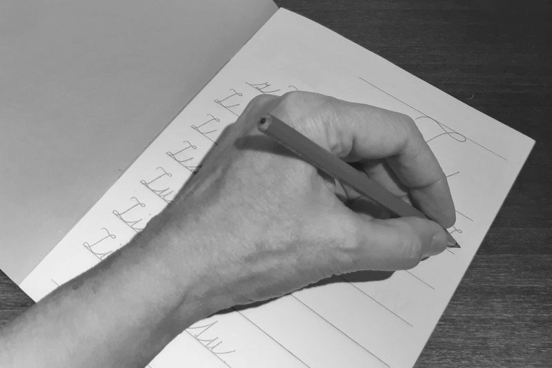
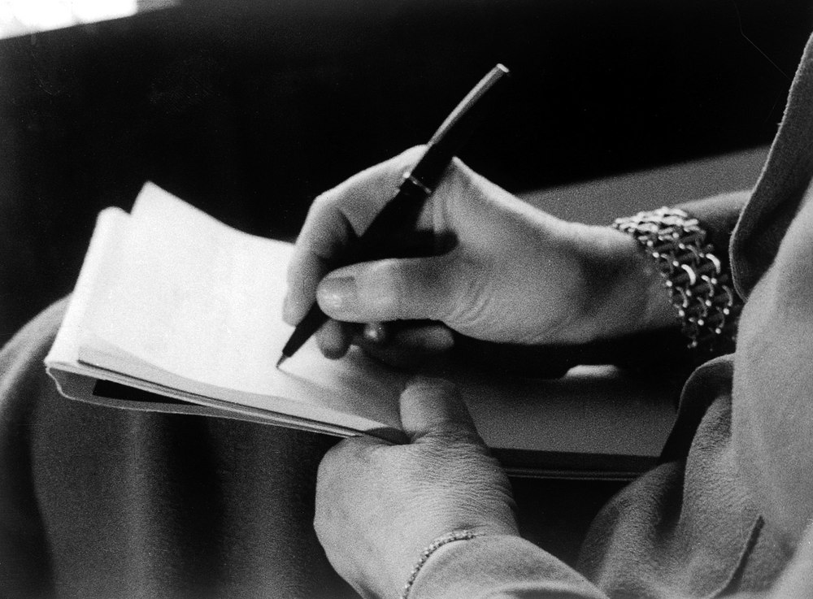
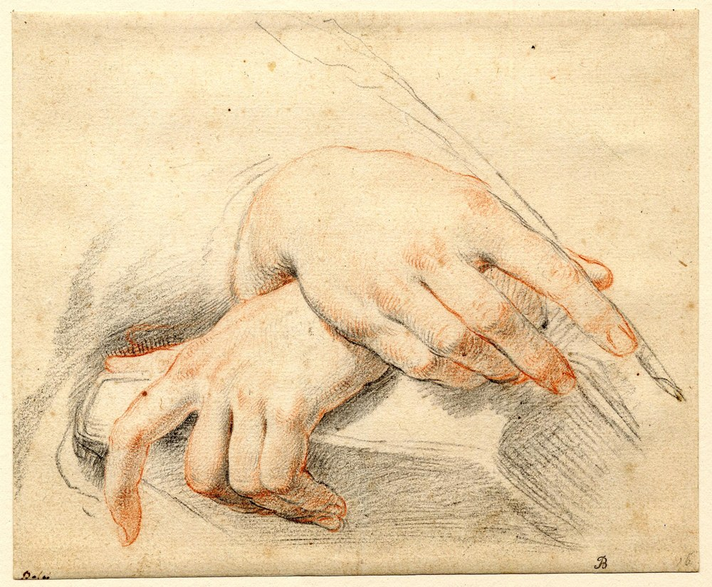

# Hand reference guide

Reusable authoring and review guide for InfiniteCorridor contributors and future models. Read this before drawing or revising a human hand, particularly a first-person Glimpse such as **The Letter**. Open the actual reference images: a filename or a verbal description is not a substitute for inspecting the pose.

This is an art-reference and evaluation pack, **not a trained model or a training dataset claim**. References support observation; they do not make a new drawing anatomically correct automatically. Passing geometry, animation or unit tests is not visual approval.

## Quick workflow

1. Open the [contact sheet](art-reference/hands/contact-sheet.jpg), then the relevant full reference-sized images below.
2. Choose one primary camera/pose reference. State its ID, handedness, camera side and what must change. Use other references for a named secondary question, not to average incompatible views into one hand.
3. Make an independent **writer-only silhouette and grayscale volume study**. Block the palm, wrist, thumb base and digit chains in one perspective; resolve rounded grip volumes and joint planes, not just landmark/shaft contact. Review this before composition, a supporting hand or motion.
4. Render the study at the game's actual intended display size as well as construction-study size. Review both the whole frame and a hand crop; a large polished crop can conceal failure at native size.
5. After the writer-only structure/volume gate passes, introduce second-hand contact and representative time samples. Add surface decoration and animation only once the composite contact also reads coherently.
6. Run technical checks and an independent visual review as separate gates. If the anatomy still fails, do not promote the scene merely because its assertions pass.

## Pose selection: The Letter

**Primary camera/pose: ID 08, left-hand writing from above in three-quarter view.**

Nessa124, CC BY-SA 4.0. [Source](https://commons.wikimedia.org/wiki/File:Doln%C3%AD_metoda_psan%C3%AD.jpg). Reference-sized derivative; [complete credit and license](art-reference/hands/ATTRIBUTION.txt).

This is a LEFT hand. For a right-handed scene, mirror the entire construction coherently: hand, wrist, forearm, thumb side, object contact and associated shadows. Do not mirror a finger independently or retain the original left-thumb placement inside a nominal right hand. Mirroring a study is not permission to copy its artwork into runtime.

**Grip cross-check: ID 07, writing mechanism from a different camera.**

Hans A. Thorner; credit Wellcome Library, London / Wellcome Images, CC BY 4.0. [Source](https://commons.wikimedia.org/wiki/File:M._Klein%27s_hands,_writing._Wellcome_L0018664.jpg). Use for barrel support, index bend, thumb opposition and curled support digits, not as a second set of screen-space coordinates to paste over 08.

**Supporting touch study: ID 06, relaxed crossed hands.**

Carlo Dolci, public domain. [Source](https://commons.wikimedia.org/wiki/File:Carlo_Dolci_-_Pair_of_hands_crossed,_resting_on_a_book.jpg). Useful for draped fingers, unequal knuckle rhythm, broad contact and contact shading.

**Unresolved reference gap:** 06 is not a second person's hand resting on a writing hand. None of the 17 references proves the exact composite Letter pose. Construct and review that interaction separately; do not label it reference-verified merely because its two components each have a reference.

## Construction rules

### One hand, one consistent volume

- Begin with a palm wedge whose width and thickness connect naturally to the wrist. The forearm does not terminate at an unrelated oval or abruptly join a rectangular palm.
- Track the forearm axis through the wrist into the hand. Wrist flexion and forearm rotation change which palm/dorsal planes are visible; shading must agree with those planes.
- Use a five-digit anatomical topology: four fingers plus one opposed thumb. Occlusion can hide digits or segments, so do not force five visible fingertips into every view. Every visible fragment must still belong to an explainable digit chain.
- For ordinary human fingers, preserve the three phalanges and the MCP/PIP/DIP bend sequence; the thumb has two phalanges and its separate saddle/base articulation. Knuckles, skin creases and painted highlight bands are not interchangeable joint markers.
- Compare visible finger/palm lengths, widths and joint-axis directions against the chosen reference in its camera; do not impose universal numeric ratios. Label hidden segments/joints as inferred in a construction study instead of claiming the source directly shows them.
- Place finger roots along an arc, not a straight comb edge. Preserve different lengths, widths and resting curl. Foreshortening changes apparent lengths, but does not justify arbitrary extra hinges or identical repeated tubes.
- Give the thumb a fleshy base and an opposed direction. It grows from the side of the palm, not from the index tip or a central hole. Preserve the thumb-index web as a volume/negative space.
- Use silhouette, joint location and overlap to communicate anatomy first. Nails, grain, wrinkles and candle highlights cannot rescue a broken hand.

### Writing grip and object contact

- Establish one straight pen axis, a visible pinch/support arrangement and a plausible nib-to-paper intersection.
- Thumb and index oppose the barrel; the middle finger commonly supports it. Ring and little fingers curl into the support mass. Real writers use varied grips; choose one coherent reference rather than treating a single tripod pattern as universal.
- Preserve thickness around the barrel. Fingers wrapping around an object occupy near and far sides; they are not flat shapes simply crossing one another.
- Decide the occlusion order for the actual pose and camera: identify the relative depth of thumb, barrel, index/middle contacts and support segments. There is no universal thumb-before-barrel ordering. Where contours meet, show which form is in front. Avoid several unrelated contours terminating at exactly one point.
- Keep the nib seated during writing intervals. But a numeric pen-contact assertion checks only contact: it cannot certify finger anatomy, grip pressure, visual balance or readability.

### Another hand resting on the writer

- Choose an entry direction and a single plausible touch region. Broad, gentle contact near the back of the hand/wrist is different from a claw gripping the fingers.
- Drape the upper hand's fingers in unequal arcs over the lower form. Use subtle compression and a small contact shadow, not deep cuts that read as fused hands.
- Make the two hands distinguishable by entry direction, silhouette and occlusion even without jewelry or color coding. Do not let the upper hand obscure the entire writing mechanism.
- Review approach, first contact, sustained touch and departure. Contact should not teleport, slide through the pen or leave a detached finger fragment. Keep the writing hand coherent when the companion leaves.
- An unresolved interaction is a reason to redesign the pose or obtain a better reference, not to add more skin detail.

## Reference index and limits

The [manifest](art-reference/hands/manifest.json) preserves stable IDs, original source/download URLs, original hashes, derivative hashes, credits and per-image caveats. The compact pack contains all 17 references; original full-resolution files are separately retained in the delivered Library corpus, not required by runtime.

| IDs | Best use | Do not infer |
| --- | --- | --- |
| 01 | Dorsal hand mass and wrist taper | It is NOT a writing grip despite its pen-related title. |
| 02–04 | Pinch silhouettes and pen-contact camera variants | 02 is a photo cutout, not 3D; 04 is a child viewed low/frontally, not an adult proportion master. |
| 05 | Economical drawn hand contours, resting/writing studies | One sheet does not define a single camera. |
| 06 | Relaxed overlap and contact rhythm | Not the exact two-person Letter interaction. |
| 07–08 | Selected writing references | Their cameras/handedness are not interchangeable. |
| 09 | Phalanx lengths, thumb distinction, joint arc | Skeletal proportions do not specify skin silhouette under every pose. |
| 11–12 | Palm pads versus dorsal structure | 12 is splayed, not relaxed. |
| 14–16 | Clear stylized volume and finger overlap | Chopstick poses are NOT pen-writing masters. |
| 19 | Real 3D scan render of clasped hands | A strong clasp is not a gentle touch. |
| 20–21 | Real 3D hand shape, finger curl and wrist depth | Two views of ONE model; 21 is a shaded Blender viewport, not a final render. Neither shows writing. |

IDs intentionally have gaps because rejected/duplicate candidates were not included. Do not renumber them when adding references.

## Native-scale and motion review

Review at the actual hand size within the intended scene, not only a zoomed editor image. Inspect portrait, landscape and desktop compositions where supported, plus low-quality rendering and the deliberate reduced-motion still. Ensure the chosen reference remains legible after the production renderer's pixel scaling and compositing.

Capture at minimum a clean writing frame, the touch interval and the departing-hand interval. Check the entire frame for wrist entry, pen/page relationship and competing detail, then a crop for topology and overlaps. Use a consistent camera, seed/time and output dimensions when comparing revisions. A side-by-side reference is more useful than several unrelated attractive hands.

## Cheap, cached code-native rendering

This guide introduces **no runtime image dependency**. Keep reference images under docs, not in game loading paths. Use newly authored, bounded Canvas geometry for game art when appropriate to the project's art direction.

- Resolve the static silhouette and joint landmarks before increasing path count or animation complexity.
- Cache stable painterly shading/texture or a small number of authored hand layers when that measurably reduces work. Invalidate caches when size, pose, palette or relevant quality settings change.
- Keep procedural noise deterministic and bounded; do not generate large textures or rebuild complex paths every frame solely to hide anatomical errors.
- Animate a coherent hand pose with a small set of intentional transforms/landmarks. Do not independently oscillate finger fragments until an unstable outline merely appears busy.
- Prefer offline/native preview capture for iteration. A cached still, source-rendered preview or successful code render demonstrates a rendering capability, not scene integration or finished art.
- Measure the actual target rendering cost. Preserve the existing offline, pause/resume, dismissal, reduced-motion and save-isolation contracts; art-reference work alone does not authorize changing them.

## Concrete failure examples from rejected Letter studies

These are observed review findings, not claims that every defect remains in a later revision:

- The writer initially read as a **mitten-like mass**, while the supporting hand appeared pasted horizontally across the wrist. More contour detail did not establish a coherent hand volume.
- The pen nib was initially below the page. Later thumb/index contact with the shaft improved, but that local repair did **not** establish convincing overall topology or volume.
- In construction studies 02/03, pale triangular infill and then diagonal ribbons inside the grip did not read as a rounded supporting finger. A shape between two landmarks is not automatically a finger segment.
- A uniform thumb shape and an isolated crease shadow did not establish changing joint planes. A labeled bone ray or a dark stroke is not evidence that the visible form follows it.

Do not copy rejected geometry as a starting template. Isolate the failed grip in a large construction study, account for visible and inferred hidden segments, and then recheck it at native scene scale. Do not use cropping or shadow to hide malformed anatomy. No extra/missing-finger claim is made here without direct evidence. Iteration/pass counts, green tests, successful renders, landmark proximity, user silence and one repaired contact do not establish visual acceptance. Independent review must say exactly what was inspected; the user retains final aesthetic approval.

## Separate acceptance gates and stop criteria

**Technical gate:** appropriate tests/checks pass for the exact changed source; contact, timing, non-mutation, cache invalidation and motion behavior are checked where relevant. Record which checks were actually run.

**Visual gate:** an independent reviewer can read the handedness, wrist connection, digit chains, writing grip and companion contact from the production-size frame. Representative motion frames stay coherent. No critical silhouette, joint, grip or occlusion failure remains.

Stop promotion if either gate fails. If repeated detail passes preserve the same structural defect, return to the blockout/primary pose rather than layering more contour bands. If the exact interaction cannot be made readable, simplify/re-stage it or request a specific missing reference. Do not assert approval based on labels such as “anatomical,” screenshot generation, contact coordinates, test totals or a reviewer who saw only code. Final owner aesthetic approval is a separate gate when user review is requested. User rejection is not cleared by independent review or a claimed repair alone; present the revised relevant evidence and obtain that requested user review before calling it accepted.

## Rights and reuse

Each image retains its own license; see [ATTRIBUTION.txt](art-reference/hands/ATTRIBUTION.txt), [license texts/notices](art-reference/hands/licenses/README.md) and the manifest. Compact JPEGs are explicitly documented derivatives: proportional resizing, EXIF orientation, alpha flattening and JPEG encoding, with no anatomical editing. Original-source hashes are retained separately from derivative hashes.

Reference study does not waive copyright or license obligations. A Canvas redraw that closely copies protected expression can still be an adaptation; “code-native” is not a licensing exemption. Keep any copied/adapted material's required credit and share-alike obligations, and review its intended distribution before incorporating it in shipped assets. Mere study of anatomy is different from copying source artwork. The pack is documentation/reference, not a blanket clearance for every derivative game asset.
